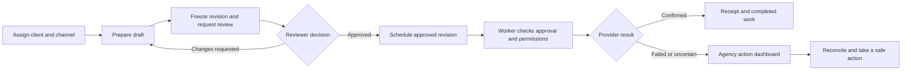

# Agency edition — BRD and software requirements

Status: agreed planning baseline, 12 October 2026. Implementation status is exclusively tracked in [project-state.json](project-state.json). Requirements below are targets, not existing capabilities.

## Business purpose and outcome

Small agencies need to prepare content for several clients, get a clear decision on the exact version, publish only what was approved, and resolve exceptions without accidentally publishing twice. Postiz supplies the editor, calendar, provider integrations and publishing engine. V1 adds the controls that connect those capabilities into an accountable agency workflow.

The first deliverable is a cloneable, reproducible local release candidate with synthetic demonstration data and a complete test path. Pricing, acquisition, billing plans, custom branding, a commercial launch and production operations are outside this project stage.

## Users and boundary

One Postiz organization represents an agency. A client is an authorization boundary within that agency, initially built on the existing Customer concept. A channel belongs to exactly one client at a time. Staff may have multiple explicitly assigned clients. Different agencies are always isolated.

| Actor | Primary job | Access default |
| --- | --- | --- |
| Agency owner/admin | Manage staff, client/channel mappings, scoped credentials and policy | Agency administration; no approval bypass |
| Editor | Prepare content, request review, respond to feedback | Assigned clients only; cannot approve or publish by role alone |
| Publisher | Schedule approved content, reconcile exceptions | Assigned clients; cannot rewrite approval history or bypass policy |
| Reviewer | Review a specific client's content and decide | Client review only; no secrets or administration |
| Automation principal | Create/read permitted content through API/MCP | Explicit client/channel/action grants; draft-only default |

Staff permissions may be composed; a staff member can receive reviewer rights explicitly. V1 does not enforce a universal two-person rule: one designated reviewer is sufficient. A person with both edit and review grants can approve their own work; the decision is visible in the audit record. The owner/admin role alone never implies review permission. Client reviewer sessions/links cannot publish.

## Primary workflow

Material edits return the item to review. A review request can include a proposed schedule, but it does not automatically queue content. Scheduling is an explicit publisher action after approval. Rescheduling creates a new revision and requires approval again in V1. More permissive timing windows belong in a later change request.

## V1 scope

Client-scoped authorization, roles, API credentials and audit history; immutable review revisions and publication enforcement; a secure mobile-friendly client review portal; an action dashboard for approvals, blocked scheduling, known failures and uncertain outcomes; and the supporting migration, tests, documentation and local packaging needed to trust those three capabilities.

Minimum private-media access checks, revision conflict checks, worker dispatch checks and a small receipt/action log are necessary V1 dependencies. They do not authorize a new asset manager, a new general editing API, a webhook platform or a publishing-engine rewrite.

## Functional requirements

| ID | Requirement | Acceptance outcome |
| --- | --- | --- |
| V1-BASE-001 | Establish a reproducible pinned baseline and safe test harness | Clean install/build and actual mock-provider workflow; versions and commands recorded |
| V1-AUTH-001 | Enforce agency/client/channel scope at every read and mutation | Client A cannot discover or affect B through IDs, lists, search, uploads, exports, previews, API, MCP or jobs |
| V1-AUTH-002 | Provide explicit human roles and scoped automation credentials | Draft-only key cannot schedule, approve, administer or reach another client; revoked grants stop future use |
| V1-AUTH-003 | Migrate existing resources without inferred authorization | Unassigned/ambiguous legacy content quarantined for admin mapping; no silent cross-client sharing |
| V1-AUD-001 | Record important changes and decisions durably | Actor, agency/client, resource/revision, action, time and outcome; authorized reads; no secrets in logs |
| V1-APR-001 | Create immutable publishable revisions and explicit decisions | Reviewed copy, media, target channels, settings and time match the version scheduled |
| V1-APR-002 | Enforce approval across every route to external side effects | UI, REST, MCP, repeat/RSS/plugs, delayed parts and worker replays cannot publish an unapproved revision |
| V1-APR-003 | Handle edits, revocation and concurrency consistently | Stale decisions and schedule requests conflict; changed material invalidates approval; dispatch races have a tested boundary |
| V1-REV-001 | Provide authenticated reviewer access or verified secure invitations | Expiring/revocable client-bound access; no bare public preview approval; invited email ownership checked |
| V1-REV-002 | Allow a reviewer to understand and decide on a weekly batch | Per-channel final content/media/time shown; approve/request changes per revision; conflict feedback on stale items |
| V1-DASH-001 | Provide a scoped action queue | Filter by client, owner, urgency and state; links to the exact revision and clear next action |
| V1-DASH-002 | Show per-target outcomes and receipt evidence | Confirmed, failed, pending and unknown outcomes distinguished; partial success never shown as complete success |
| V1-DASH-003 | Resolve exceptions without unsafe duplicate mutations | Retry only known-safe failed target; reconcile unknown first; repeated clicks cannot enqueue duplicate actions |
| V1-REL-001 | Produce a local, repeatable V1 release candidate | Fresh clone setup, seed, test, shutdown/restart and backup/restore demonstrated; known limitations included |

Audit entries cover assignments, credential creation/revocation, review access, review requests/decisions, approval invalidation, schedule/cancel, dispatch claim, receipt updates and dashboard actions. Access decisions may use redacted security logs rather than recording sensitive denied payloads.

## Nonfunctional requirements

| ID | Requirement and measurable gate |
| --- | --- |
| V1-NFR-001 | Security: automated cross-agency/client denial tests, stale/revoked identity tests, protected media tests, and review-session CSRF/XSS coverage. No unresolved critical/high authorization or publishing defect. |
| V1-NFR-002 | Reliability: duplicate commands, worker interruption and provider timeout tests show bounded recovery with no extra mutation after an uncertain result. Repeated approval/cancel/retry requests have stable effects. |
| V1-NFR-003 | Usability: prepare → review → approve → schedule → resolve path works at 360px and desktop widths with keyboard navigation, focus indicators and accessible action labels. State is conveyed beyond color. |
| V1-NFR-004 | Performance target: on a recorded 4-vCPU/8-GB test profile, 50 clients, 100 channels, 10,000 work items and 10 concurrent dashboard users, p95 dashboard API response ≤1s over 200 measured requests after warmup, and page usable ≤3s under documented local conditions. Adjust a target only with evidence and an explicit decision; never silently pass a slower result. |
| V1-NFR-005 | Maintainability: migrations versioned and rehearsed, requirements mapped to tests, complete lint/type/build commands for changed services, dependency updates justified, Temporal workflow changes replay-tested where applicable. |

These are engineering acceptance targets, not SLA promises. Record hardware, data volume, test method and any deviations.

## Platform coverage and delivery claims

Preserve inherited providers wherever possible: Facebook Pages, professional Instagram, LinkedIn profiles/Pages, TikTok, YouTube, X, Threads, Pinterest and Google Business Profile are priority compatibility targets. Others remain inherited integrations. V1 adds shared agency controls rather than new provider APIs.

Phase 0 inventories every publishing entry path and provider capability. Phase 5 checks the shared controls using mock contracts across the priority set and live test accounts only when the owner supplies approved apps/accounts and authorizes publishing. In the support matrix, distinguish `mock verified`, `live verified`, `inherited/unverified`, `externally blocked` and `disabled`. Never label all popular networks production-ready because a shared test passed. TikTok inbox upload and direct publication must have different outcome labels.

## Exclusions and release limits

No analytics redesign/correction project, durable customer webhooks, RSS expansion, general REST/MCP edit parity, intake deduplication product, richer brand AI, asset folders, autosave project, client reports, social inbox, new onboarding wizard, timezone profile product, extra networks or mobile rewrite in V1. See [V2 backlog](V2-BACKLOG.md). Security/access enforcement applies to inherited surfaces even when their enhancements are deferred: gate or disable unsafe access paths rather than leaving a bypass.

Known inaccurate inherited analytics must not be promoted as verified V1 reporting. An inherited feature may remain unsupported/hidden with a documented reason; disabling it must be enforced on the server when it could bypass V1 controls. If a small baseline defect blocks a V1 criterion, record the narrowly scoped fix and evidence. Broader enhancement work stays in V2.

## Completion definition

All V1 requirements trace to executed acceptance tests; phases 0–6 are evidenced; release-blocking bugs are resolved; migration and restore work; and another machine can clone the exact release branch/commit and run the documented synthetic workflow. Provider access that cannot be verified is listed openly and does not turn a local release candidate into a production release.
