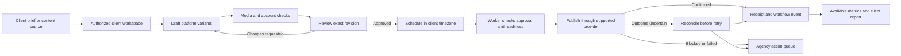

# Postiz: user feedback, feature audit, and an agency automation product

Research date: 12 October 2026. Audience: small agencies managing multiple clients. Platform scope: major social platforms wherever supported publishing APIs and approvals make the workflow possible.

## Recommendation

Build an agency operations layer around Postiz's publishing engine. The most defensible first product is a complete path from content intake to approval, publication, recovery, and client reporting.

The strongest additions are enforced, version-specific approvals; permissions scoped to a client; dependable automation events; and an agency dashboard that tells staff what needs action. Improve the existing editor, calendar, and integrations rather than replacing them. Generic AI generation, another calendar, or simply more platform logos would add less value.

There are also defects and inconsistencies to resolve before adding features. In the inspected source, some analytics trends are hard-coded, webhook delivery is best-effort, and the RSS implementation does not match the documented automatic-publishing behavior. These deserve attention before promising unattended automation.

This is a research and static source audit. It is not proof that a deployed instance or every provider works. No live account connections, publishing tests, performance benchmarks, security penetration tests, or agency interviews were performed.

## Research method and limits

I collected 88 detailed public GitHub pages: 68 issues, 16 discussions, and four releases. The issues were opened by 59 distinct GitHub accounts. I used issue searches across approvals, analytics, duplicates, webhooks, APIs, mobile, bulk operations, timezone, teams, media, AI, notifications, customers, permissions, and imports. These were purposive searches for relevant product evidence, not a statistically representative sample.

I inspected the upstream application at commit `3a7d28b7ad9654063f4f1f3938b8fe5d1590bf8f`, dated 12 October 2026, and the documentation repository at `9c2e22265236ca9ba5b98f1fb94d8eb8e81b8bcf`, dated 7 October 2026. The inventory covers all 39 general-guide pages, the public API documentation inventory, registered providers, relevant data models, and representative implementations. Findings below cite the pages and source paths that substantiate them; collection counts do not mean every comment was independently verified.

The latest published release observed was **v2.25.1**, released 11 October. The original research's v2.24.0 reference is already behind this release. Main contains additional changes, so findings against main and release behavior must not be assumed identical.

Reddit, Trustpilot, Product Hunt, Google search, the GitHub API host, and the Postiz website/documentation host returned network-policy denials in this environment. The official documentation was accessible through its GitHub repository. Consequently, this report has strong source and technical-community coverage but incomplete independent-review coverage. It cannot establish overall satisfaction, market-wide demand, churn, or the prevalence of any complaint. No review scores or star counts are used as satisfaction evidence.

Evidence labels used throughout:

- **Documented:** explicitly described by current official documentation.
- **Source-confirmed:** the behavior or limitation is visible in the inspected code; not necessarily reproduced at runtime.
- **Reported:** a user describes it; their environment and current reproducibility may differ.
- **Proposed:** a product improvement or architectural recommendation that needs validation.

GitHub bots are not treated as customers. An issue being open does not establish that its bug remains present. An issue being closed does not establish that it was fixed: this repository automatically marks issues stale after 90 inactive days and closes them seven days later. Some requests closed as “not planned” were closed by that bot, rather than explicitly rejected by a maintainer. [C16]

## What people like

### The interface and breadth attract interest

In discussion #1789, a self-hoster explicitly says “User interface looks great!” while describing a difficult setup and uncertainty about releases. This is useful mixed feedback: the interface creates interest, but operational friction can still prevent activation. A maintainer explains that cloud deploys recent main commits while self-hosted releases are published when considered appropriate. Do not misinterpret release lag as proof of a hidden proprietary feature set. [U1]

In discussion #185, a commenter calls Postiz an “amazing tool” and praises the breadth of its open-source features, then requests approval and role controls. In discussion #666, another user praises the software while requesting Canva integration, better analytics, engagement tools, and mobile access. Those are individual positive comments with specific unmet needs, rather than evidence that everyone likes every feature. [U2, U3]

### Existing capabilities solve real work

Discussion #982 ends with the user discovering that connecting additional accounts is simple: add another channel. Discussion #781 ends with “Thank you. It worked.” after MCP configuration guidance. Both demonstrate successful outcomes, though the MCP example is historical and setup has since evolved. [U4, U5]

Issue #1944 describes an organization operating 12 channels across five markets and extending an older Postiz fork with an inbox and combined analytics. The author reports using these extensions in production. This is a concrete use case for extending Postiz, not independent verification of the fork, its security, its performance, or any third-party publishing service it recommends. [U6]

### Strengths worth preserving

Official documentation and source show substantial functionality already available: multiple accounts and organizations, client channel groups, connection invite links, global/per-channel copy, drafts, calendar views, repeats, reusable channel sets, signatures, media management, previews with comments, platform analytics, RSS ingestion, plugs, API/SDK integrations, webhooks, MCP, AI generation, and video clipping. [D1–D13]

The product opportunity is to make these capabilities work as one understandable agency process. Several requests are about access, orchestration, clarity, and recovery rather than the absence of a scheduler.

## Recurring friction and its implications

| Theme | Evidence | Interpretation | Product response |
|---|---|---|---|
| Client and internal approvals | #1758, #1481, #1255; current approval docs | Multiple independent requests and an explicit documented limitation | Enforce approval of an exact version at the server and worker |
| Automation permissions span too much | #1587, #1511; API auth source | Client filters exist, but filtering is not a permission boundary | Issue multiple scoped, revocable automation credentials |
| Connection and account readiness | #2120, discussions #937 and #1709; provider docs | Deployment success does not establish permission to publish | Guided account readiness, scope diagnostics, test publication |
| Failed or uncertain publishing is difficult to operate | #2011, #1748, #2035, #2231; workflows and health endpoint | Platform errors and worker failure need different responses | An exception queue, stage-specific diagnosis, careful reconciliation |
| Webhooks are too limited for a complete workflow | #1191, #1153; current sender | Published-only, best-effort events are insufficient for business automation | Signed lifecycle events with durable delivery records and replay |
| Analytics need trust and client-level presentation | #1911, #1821, #2055, #2056, #1944 | Accuracy and availability matter before prettier reports | Fix calculations, expose freshness, distinguish unavailable from zero |
| Media administration grows painful | #1517, #933, discussion #1552; media docs/model | A flat organization library becomes awkward across clients | Client asset folders, tags, reference-aware deletion, bulk operations |
| API, MCP and UI capabilities differ | #1218, #1778, discussion #2192; routes and tool list | Automation can create work that a human must later repair | A documented operation-parity matrix and stable edit/reschedule commands |

These are repeated themes, not a ranking by measured customer prevalence. Different issues sometimes describe the same underlying problem. Requests, cloud incidents, old-version defects, and deployment misconfiguration are kept distinct.

## Complete feature-family audit

This table covers documented product families. It is not a claim to have tested every control, undocumented admin endpoint, or platform/account combination.

| Feature family | Existing behavior | Weakness or friction | Recommended action |
|---|---|---|---|
| Registration, login, invitations | Local and external sign-in; organization invites | Reports of invitations losing organization context; users confused about active account | Verify invite expiry/acceptance, display account and organization clearly; investigate #2199 before treating it as current |
| Organizations | Multiple organization membership and selector | Source uses a hover dropdown and full reload; no aggregated agency overview identified | Persistent searchable selector; active identity always visible; authorized overview across client workspaces |
| Customer/client groups | Channels grouped and calendar filtered per customer | Customer model primarily stores a name and channel association; groups are not access controls | Extend into a client profile with assigned staff, approvers, brand rules and timezone; enforce access independently |
| Client connection links | Clients authorize accounts without joining Postiz | Limited to suitable redirect flows; developer-app setup still needed | Keep; add a guided connection status page and safe return-to-onboarding flow |
| Channel administration | Reconnect, rename, disable, delete, time slots | Connection success can precede later publication failure; developer credentials are generally instance-wide | Show publishing/analytics readiness separately; identify app credential used for refresh; add isolated overrides only if needed |
| Composer and cross-posting | Global copy plus detached per-channel versions and previews | Platform-specific controls are discoverable only inside the composer; global editing differs when reopening posts | Keep; show a per-channel readiness checklist and clear variant relationships |
| Writing and drafts | Rich/plain/HTML/Markdown editors, mentions, undo, explicit draft saving | Docs say closing discards unsaved content | Add autosave, recovery and revision history; separate private reviewer context from publishable copy |
| Calendar | Day/week/month/list views, client filtering, drag/drop | Calendar makes planning visible but is not a complete approvals or exception queue | Keep; add “Needs approval,” “Blocked,” and client-level action views |
| Time slots and recurring posts | Channel slots, repetition intervals | Browser timezone is documented; no client-level zone setting documented; recurring semantics can surprise | Store IANA client/channel timezone and recurrence intent; show staff and audience times; test DST |
| Tags, sets and signatures | Campaign labels, reusable channel/settings sets, reusable text | Sets do not store detached copy; signatures may apply across unsuitable platforms | Add client/platform-specific defaults and named content templates; preserve simple sets |
| Media upload | Library picker, drag/drop, clipboard, cover frames, alt text | Successful upload is not complete provider validation; large-file and cancellation friction | Inspect codecs/duration/dimensions server-side; explain constraints; expose processing progress |
| Media library | Organization-wide pagination and filename search | No client/folder hierarchy in inspected model; docs warn deleting referenced media can break scheduled posts | Add ownership, folders/tags, references and safe archival; bulk actions with safeguards |
| Design editor | Embedded Polotno editor | Self-hosted production use needs a separate commercial SDK license | Keep optional; provide a complete import workflow; review SDK terms before bundling |
| AI text, image and video | Generation in composer/agent, post generation, separate services | Hard-coded models in inspected paths; image-generation incompatibility reported and documented | Centralize provider configuration, isolate failures, use client brand profiles and source-backed draft generation |
| AI agent | Lists/schedules posts, updates settings, generates media, retains conversation memory | Broad organization credentials; prompt confirmations are not mandatory server policies; no delete tool | Draft-first mode enforced by permissions; scoped tools; explicit approval before publication |
| Video clipping | YouTube source to captioned vertical clips and drafts; API/CLI/MCP | YouTube-only input; crop has no face tracking; dependencies add operating complexity | Keep optional; improve review and caption correction before expanding to original uploads |
| Threads and follow-up comments | Platform-dependent extra parts and delays | Partial failures need a clear record; platform capabilities differ | Show results per part; retry only known-safe unfinished parts; previews explain actual platform behavior |
| RSS automation | Active feeds, AI rewrite/image options, draft creation visible in source | Docs describe autopublishing, but inspected path creates drafts; newest-item-only ingest and swallowed workflow errors | Clarify mode; ingest all unseen items with deduplication; add run history, filters and explicit approval/publish policy |
| Plugs | Like-triggered repost or follow-up automation on a limited platform set | Limited platform coverage; repeated engagement actions can create noise | Keep as advanced opt-in; add caps, cooldowns, dry runs, per-client disable and run history |
| External media integrations | Import output from tools such as HeyGen | Separate credentials and inconsistent service availability | Keep optional; show configuration and job status; avoid broadening integrations before core workflow is reliable |
| Public API/SDK/CLI | Upload, create/list/delete posts, status/settings operations, analytics and helper calls | No clear documented general PATCH/reschedule contract; per-channel dates omitted by create route; no create-request idempotency contract identified | Add stable edit/reschedule and bulk contracts, request idempotency, optimistic versions, parity tests |
| MCP | Discovery/schema helpers, creation, lists, media, settings, clipping | Different operation coverage from REST/UI; scheduling tool does not accept the same full metadata | Publish capability/parity table; add scoped edit/reschedule/archive tools; retain multipart uploads via REST/CLI |
| Third-party OAuth apps | Authorization, app management and revocation | Presence of OAuth does not establish fine-grained client permissions | Apply the same client/action authorization model to OAuth, API keys and tools |
| Outbound webhooks | Channel-scoped publication callbacks and test action | Current sender has no signature, delivery table, HTTP success check or retry policy in the inspected path | Add an outbox, versioned event IDs, signing, bounded retries, delivery history and replay |
| Notifications | In-app notices, email preferences, batched email workflow | Digest source waits one hour; critical issues may need faster action | Immediate actionable failure/block alerts; success digest; preference-aware deduplication and escalation |
| Analytics and post statistics | Account and post metrics on supported providers, link clicks, manual live-post association | Hard-coded trend values; inconsistent empty states; disparate platform definitions | Fix trust first; retain native metric meaning; add freshness/errors and client reporting |
| Short links | Organization preference and configured shortening provider | Link stripping or automatic transformations can alter reviewed text; custom domain request remains | Show final transformed content before approval; preserve links by default; client-scoped branded links later |
| Mobile and localization | Responsive work, language support, including Bangla locale | Earlier complaints exist but recent releases improved responsiveness; translation presence is not editorial quality | Test actual mobile approval/recovery tasks; improve Bangla terminology and caption quality, not just add a translation toggle |
| Deployment and maintenance | PostgreSQL, Redis, Temporal, application workers, storage, email and optional AI | Startup dependencies can leave “online” processes unable to publish; optional AI initialization can block backend | Check worker polling and queue age; make optional components degrade independently; test backups and upgrades |
| Admin/support surfaces | Debug endpoints and operational source tracking | Debug routes are not a substitute for durable customer-visible audit history | Authorized support tooling with redaction; client-visible publication receipts and audit records |

Feature evidence: [D1–D13], [C1–C16]. User evidence is detailed in the source list and topic table above.

## Source-confirmed issues that change the roadmap

### 1. Approval is not an enforced publishing permission

The approval guide explicitly states that previews are unlisted, not password-protected, and there is no approved flag that blocks publishing. The team model has User, Admin and Super Admin roles. Current post states are Draft, Queue, Published and Error; the separate order-related approval field must not be mistaken for general client approval. [D2, D3, C1]

Add an approval record tied to a revision. The approved revision should include caption, media, target account, relevant provider settings, disclosure flags, link transformations and timing policy. Changes outside the approved policy invalidate approval. The publishing worker must recheck the revision and authorization immediately before sending anything. This must apply to UI, REST, RSS, MCP and recurring jobs.

For the initial product, use one client approver or an explicit “any one of these people” rule. Multi-stage committee approval is a later feature. Use expiring, revocable review links; reviewer verification can be configurable. Provide an internal-note surface that is excluded from public previews and provider payloads.

The earlier proposed external review implementation in #1255 is useful prior art, but was auto-closed and is not present in the inspected mainstream schema. It should not be described as an already shipped feature. [U7]

### 2. A client filter does not isolate an automation agent

The Organization model has an API key field. Public API authentication resolves an organization and sets a super-admin context. Client groups can filter lists, but that is not an authorization restriction. Issue #1587 specifically describes an agent for Brand A being able to reach Brand B's channels with an organization credential. [C1, C3, U8]

Add multiple credentials with permitted client IDs, channel IDs, actions, expiry and revocation. Separate “create draft,” “edit draft,” “request approval,” “approve,” “schedule,” “publish now,” and “read analytics.” Filters supplied by a caller must never expand its permission scope. Prompt instructions and hiding UI buttons are insufficient.

For the earliest deployment, separate organizations per client can reduce accidental cross-client work while granular access is being built. That is an interim choice, not proof that tenant isolation is secure. Test all authorization paths. Also separate subscription entitlement checks from role authorization: the inspected permissions service relaxes policy checks when Stripe is unconfigured, which deserves explicit review in a managed self-hosted product. This static observation is not a demonstrated exploit. [C4]

### 3. Webhooks need a reliable event system

The sender makes POST requests with JSON, catches failures, and does not check the response status. The inspected webhook model stores endpoint configuration but no delivery ledger or signing secret. The comments explicitly describe best-effort behavior. [C5]

Do not make the publishing activity fail because a reporting endpoint is down. Preserve that separation, then add a durable outbox and separate delivery jobs. Events should include an event ID, type, schema version, client/organization, post/revision, channel, timestamp, and outcome. Useful event types include draft created, approval requested/granted/rejected/invalidated, scheduled, blocked, published, failed and outcome uncertain.

Sign deliveries, constrain sensitive payloads, retain attempts and HTTP outcomes, retry with bounded backoff, and offer replay. Receivers should deduplicate by event ID. Never promise exactly-once webhook delivery; an at-least-once contract with idempotent receivers is realistic. #1191 asks for lifecycle events; #1153 asks for better delivery logging. The old empty-payload defect in #1861 is addressed in v2.24.0 release notes and should not be counted as currently confirmed. [U9, U10, R2]

### 4. Analytics accuracy comes before presentation

The inspected Facebook, Instagram, Threads and LinkedIn Page provider paths still contain `percentageChange: 5`. The frontend displays it as a positive percentage. This substantiates #1911's concern without needing to infer accuracy from a chart screenshot. [C6, U11]

Remove that indicator until there is a real prior-period comparison, then compute it with explicit date ranges. Label cumulative snapshots separately from daily observations. Use unavailable/error/stale/zero distinctions. Never combine platform “views” into a unique audience estimate, and never average engagement percentages blindly: retain denominator and platform semantics or show separate platform results.

The doubled Instagram totals in #1436 were closed as completed through a fix; this is historical evidence about test needs, not a current claim. Requests for combined analytics and more meaningful engagement signals remain useful product evidence. [U12, U6, U13]

### 5. RSS needs a clarified and observable contract

The inspected RSS parser chooses the most recent item. The polling workflow waits one hour and swallows exhausted errors. `schedulePost()` creates posts with `type: 'draft'`; `onSlot` and `syncLast` are stored by the repository but are not consulted in the inspected processing path. In contrast, the guide describes new feed items becoming scheduled posts, with immediate/slot behavior. [C7, D6]

This source/documentation discrepancy needs a real fixture test before any unattended RSS promise. A feed adding several items between polls may have only the newest selected by this implementation. Do not label that as a reproduced customer incident; it is a source-derived consequence to test.

A suitable replacement contract is: ingest all unseen items by stable identity, retain a processing ledger, generate per-channel drafts, apply approval policy, then schedule only permitted output. Keep configurable feed filters, maximum posts per day, replay/backfill controls, run errors and source links. Mark an item processed atomically with persisted output so interrupted retries cannot create duplicates or lose items. Use the same workflow for other intake sources later.

### 6. API edit support is an operation-contract problem

Current REST supports creation, deletion, settings-only updates, status changes and release-ID association. MCP has lists, creation and settings-only tools but no deletion tool in the inspected registry. REST accepts multipart local uploads and the media DTO supports alt text; the create DTO also supports tags. Therefore discussion #2192's broad claim that these cannot be done “via the API” is too broad. Its report of MCP/parity gaps is more credible than treating all four complaints as missing REST capabilities. [C2, C8, U14]

The backend has update/upsert primitives. There is no dedicated general content/date PATCH route in the inspected public controller, and docs do not offer a stable general edit/reschedule contract. It would be incorrect to conclude that all underlying editing is impossible. Add a supported endpoint/tool that preserves identity, validates revisions, reschedules the worker correctly and invalidates approval when appropriate. [C2, C9]

The public create route explicitly strips per-channel dates even though the dashboard supports them. Add a clear API contract for campaign variants with independent times, rather than claiming this is already equivalent. Add request-level idempotency for intake; provider-level duplicate protection does not prevent a caller accidentally creating the same campaign twice.

### 7. Existing retry protections should be preserved

Workflow v1.1.2 distinguishes read-only status probes from irreversible publishing operations. It avoids blindly retrying mutations after an uncertain timeout and handles activities that never started differently. Heartbeats, pending/finalize flows, curated errors and missing-post monitoring already exist. [C10, R1–R3]

Do not replace them with an “auto retry every failure” switch. Extend the operator experience: show the last known stage, external identifier, whether publishing is confirmed, and the next safe action. A timeout can mean published-but-unconfirmed; status checks or an authorized manual association should precede a fresh publish attempt.

There are worker-initialization failure reports in #1748 and #2035. The health endpoint in the inspected orchestrator checks Temporal connectivity and namespace availability; it does not demonstrate that a worker is polling and processing jobs. Add worker-poller readiness, queue age, overdue-job detection and a canary path. [U15, C11]

### 8. Optional AI must not take down scheduling

The backend awaits MCP initialization before it listens. The reported Mastra-storage failure in #2227 matches that initialization ordering. The agent source chooses a hard-coded OpenAI model and uses conversation/working memory; it is not a documented client brand-management system. [C12, U16]

Retain conversation memory, but add an explicit client profile: allowed claims, prohibited wording, approved examples, preferred languages, terms, references and disclosures. Resolve that context by authorized client ID. Centralize provider/model settings and feature capability checks. When AI fails or is unconfigured, ordinary scheduling and approval should continue.

The known-issues guide and #1711 document an image-generation compatibility issue. The inspected RSS path still uses the named wrapper/model combination implicated in that report, but the external request was not executed here. Treat it as a targeted regression-test item. [D12, U17, C7]

## Major-platform assessment

This is a capability and friction map, not a certification of production publishing. Provider-specific legal/API rules must be rechecked directly before implementation; platform documentation hosts were not independently reachable here.

| Platform | Existing Postiz direction | Main friction/constraint | Improvement and launch condition |
|---|---|---|---|
| Facebook Pages | Text, images, video, stories, comments and metrics | Business verification/app permissions; media and page-token failures | Guided permissions/page checks; validate each post type; publish and retrieve a real receipt |
| Instagram professional accounts | Facebook Business and standalone connections, media/reels/stories, collaborators and metrics | Connection variants differ; media retrieval/processing; account and API constraints | Capability-aware setup; per-media diagnosis; test relevant formats, covers, disclosure and account type |
| TikTok | Direct Post and upload-to-inbox; separate Business provider | Audit/user caps; Direct Post UX requirements; upload is not automatic publication | Verify current guidelines; never preselect forbidden consent/privacy choices; expose direct vs manual-completion status clearly |
| YouTube | Video uploads, titles/privacy/tags/thumbnails, metrics, clipping source | OAuth lifecycle, upload processing, quotas and uncertain outcomes | Verify connection refresh and resumable uploads; keep stage/status evidence; distinguish upload accepted from public/processed |
| LinkedIn profiles | Text/media/document-style carousels and threads-as-comments | Required products/scopes; profile vs Page capabilities differ | Simplify profile-only scopes where supported; test approved product access and format behavior |
| LinkedIn Pages | Company publishing, comments, analytics | Organization roles and app access; API versions | Test actual content-admin account permissions; monitor API version lifecycle; retain native metrics |
| X | Posts/threads/media, premium-dependent options and articles | API entitlement/credits and rate limits; #2231 reports poor 402 explanation | Explain entitlement and rate failures; test exact supported API plan; preserve reviewed links and disclosures |
| Threads | Posts/media/replies and analytics | Byte/character counts and topic-feature parity | Validate non-Latin and emoji examples; expose supported settings; do not assume UI and platform character limits are identical |
| Pinterest | Boards, image/video pins, metrics | App approval, board identity, video cover and media retrieval | Onboarding checks for board/access; validate required cover and format before queueing |
| Google Business Profile | Updates/events/offers, CTA and performance | API access approval and verified locations | Location access diagnostic; validate event/offer fields; confirm returned status and live receipt |
| Reddit | Subreddit-specific text/link/media/flair | API access and subreddit rules; automation is not appropriate everywhere | Treat as optional publishing with explicit subreddit rules, preview and conservative rate handling |
| Bluesky | Posts/threads/media with app-password connection | Instance/login/media limits; native analytics not uniform | Good early automation target if agency demand exists; test account and media flow; show analytics availability honestly |
| Mastodon | Instance-based publishing and threads; provider-level idempotency support | Instance-specific rules/limits and account reach | Resolve instance capabilities; preserve content warnings where supported; test instance rather than assume uniform behavior |
| Telegram | Bot/channel publishing | Bot ownership and channel permissions; not a substitute for social audience metrics | Clear permission test and receipt; useful for an agency's internal alerts as well as authorized client channels |
| Discord / Slack | Bot/channel publishing | Different scopes and permissions; historical false-success reports | Test destination membership/permissions and HTTP/application errors; use as supported workflow destinations |
| WordPress / other publishing platforms | Long-form content, titles, settings and credentials | Rich-content mappings and connector UI coverage differ | Warn if attachments are not mapped; keep optional for content syndication |
| WhatsApp | No registered provider found in inspected list; request #1888 | Business messaging is not the same as publishing Channels or Status | Do not promise support until a suitable official product/API and permission path are confirmed |

The guide says “34 platforms,” while the inspected registry has 35 provider entries, including separate Instagram, LinkedIn and TikTok variants. Those entries are not 35 distinct mainstream social networks. Public docs also distinguish providers without a complete in-app connection flow. A logo list must not substitute for an account-type/content-format support matrix. [D9, C13]

Additional registered or documented providers include Dribbble, Kick, Twitch, Lemmy, Farcaster, Nostr, VK, Medium, Dev.to, Hashnode, Listmonk, Moltbook, Whop, Skool, MeWe and Tumblr. For these, retain optional connectors and apply the same connection, capability, receipt and recovery requirements. Skool's documented browser-extension route should be labelled separately from OAuth/API publishing. Do not spend early development effort making all niche providers prominent for agencies.

## What to change, hide, remove, and add

### Keep and improve

Keep Postiz's composer, calendar, platform providers, Temporal-based publishing, media uploads, client groups, previews/comments, API/CLI/MCP, reusable sets and supported analytics. These are a large base to build upon.

### Hide or make optional

- Hide niche providers by default and let agencies enable the ones they use. Current `HIDDEN_PROVIDERS` already provides an instance-level mechanism.
- Put plugs, AI video, clipping and advanced developer settings behind deliberate feature selection. They need not dominate the agency's daily navigation.
- Keep the licensed design editor optional. Do not make an unlicensed SDK demo an essential production workflow.
- Keep gamification/streak displays secondary. They should never influence the correctness of publishing.
- Keep any upstream marketplace/community or affiliate flows separate if exposed in a chosen build. The self-hosted guide already says some of those are hidden; do not “remove” features that are already absent.

### Remove or replace problematic behavior

- Replace hard-coded analytics growth with a calculation or omit it.
- Replace ambiguous success wording with “Draft saved,” “Scheduled,” “Submitted,” or “Publication confirmed,” as appropriate.
- Replace generic reconnect prompts when the real issue is missing scope, unavailable metrics, exhausted credits or processing delay.
- Replace manual link transformations with an explicit final-content preview before approval.
- Replace undocumented implicit edits and delete/recreate workarounds with a stable revision-aware update API.
- Remove the dependency of normal startup on optional AI readiness through a supported graceful-degradation design.

This is a behavior/UI simplification proposal, not a recommendation to delete provider source or rewrite the application. A small set of well-separated extensions makes upstream upgrades more manageable.

### Add first

1. Client-scoped credentials and roles.
2. Revision-specific approvals and an expiring weekly review page.
3. An agency exception queue and publishing receipts.
4. Durable lifecycle webhooks and intake idempotency.
5. Stable edit/reschedule operations and an API/MCP parity contract.
6. Client brand profiles and source-backed internal notes.
7. Safe client asset management, autosave and revision history.
8. Trustworthy branded reports using supported metrics.

### Add after the core workflow is dependable

A Facebook/Instagram comments-and-messages inbox is a promising later extension, supported by #1944 and discussion #666. It is a substantial new synchronization product, with extra scopes, reply windows, deduplication, team assignment and retention requirements. Do not advertise an inbox for every platform. Start with one supported provider family.

Other later options: verified design-file import, spreadsheet/CMS intake, Instagram grid planning, caption editing for clips, and client-specific branded link domains. Avoid automatically reposting “top performers” until approval, metric definitions, frequency caps and platform rules are established.

## The proposed agency workflow

The agency home screen should answer four questions: What needs approval? What could miss its deadline? What needs reconnecting or correction? What published successfully? The calendar remains a planning tool alongside this screen.

A campaign should have a parent identity, platform variants, immutable revisions, approvals, delivery attempts and receipts. Each platform can succeed or fail independently. Do not describe a five-platform publish as a single atomic transaction. Record partial success and retry only eligible unsuccessful variants.

For unavailable automated formats, offer an honest handoff: an asset package, scheduled reminder, assigned person and completion confirmation. Native stickers, music or unsupported account types may require a human. “Manual completion required” is a valid workflow state; it must not be represented as an automatic published result.

Automation templates should be thin configurations of this same lifecycle:

- Approved weekly campaign → channel-specific slots → publication receipts.
- RSS or CMS item → source-backed draft → approval → schedule.
- Original video or supported YouTube clipping → variants → caption review → schedule.
- Brand event → platform-specific draft set → named approver → deadline escalation.

Start with one or two templates. A generic visual workflow builder is much more work than tested templates using the existing API and an orchestration tool such as n8n.

## Build sequence and scope

Effort labels are relative estimates, not delivery promises. Platform approvals and production support can dominate the calendar regardless of coding speed.

| Milestone | Scope | Why this order | Complexity |
|---|---|---|---|
| Baseline | Choose supported release; validate two-provider workflow; map source/docs discrepancies; backups, auth and upgrade checks | Prevent extending an unproven installation | Medium; externally dependent |
| Agency control | Client boundaries, scoped credentials, exact-revision approvals, weekly review links, explicit client identity | Prevent wrong-client and unapproved publishing | Large |
| Reliable automation | Durable events, receipts, exception queue, uncertain-outcome reconciliation, intake deduplication | Make repeated unattended runs understandable | Large |
| Editing and intake | Stable patch/reschedule, bulk dry run, source notes, autosave, initial CMS/RSS template | Reduce manual repair and repetitive agency work | Medium to large |
| Client delivery | Honest metrics, scheduled branded reports, asset organization, mobile review polish | Complete the service workflow and improve retention | Medium to large |
| Optional expansion | Additional provider formats, inbox, advanced clipping and integrations | Broaden after the core is proven | Large and externally dependent |

Start by validating Facebook/Instagram formats if those are what initial agencies need. Where approvals are not yet available, use accessible supported test accounts/providers to validate the architecture while starting app review work. The user's long-term goal covers major platforms; it does not require launching every provider in the first build.

An initial one-week engineering slice could be a running upstream demo, a verified single-client/two-provider publishing path, a minimal weekly draft review page, and an exception list. Enforced approvals across every creation path, a robust multi-client authorization model and a cross-platform inbox should not be bundled into a one-week promise.

## Acceptance checks before claiming an agency-ready product

| Scenario | Required observable outcome |
|---|---|
| Agent credential belongs to Client A | Requests for Client B's channels, posts, media or approvals fail server-side |
| Draft arrives through UI, API, RSS or MCP | Same authorization and approval policy applies |
| Approved caption/media/account/settings changes | Approval is invalidated and the old approval cannot authorize the changed payload |
| Review link expires or is revoked | It no longer reveals review content or accepts decisions |
| Two approvers act or post is edited during review | Revision/version conflict is explicit; no silent overwrite |
| Account loses a required scope or is revoked | Upcoming affected posts are surfaced with the correct action; unrelated clients continue |
| Scheduled date crosses DST or staff travels | Publication follows the declared client timezone and recurrence rule |
| Same intake request is retried after a network timeout | The stored campaign is reused according to the idempotency contract |
| One platform succeeds and another fails | Results remain separate; the successful platform is not republished during recovery |
| Provider times out after accepting the upload | Outcome is uncertain until reconciled; no blind duplicate |
| Webhook receiver returns 500 or is unavailable | Publishing remains successful; delivery is recorded and retried; replay uses the same event identity |
| RSS contains several new items between polls | Every eligible unseen item appears once; filters/backfill behavior is explicit |
| Media referenced by a queued post is archived/deleted | References are protected or the affected workflow is explicitly blocked before publishing |
| AI provider is unavailable or unconfigured | Manual drafting, approval and ordinary scheduling remain usable |
| Analytics API returns no data, zero, stale data or an error | UI and report distinguish the four cases; growth is calculated only from real comparable data |
| Worker process is alive but not polling | Readiness/overdue-job monitor identifies the failure |
| Backup is restored and service restarts | Drafts, approvals, scheduled jobs, media and required credential references remain coherent |
| Mobile client reviews a weekly batch | Review, comments, approve/reject and relevant context work without desktop hover interactions |

Use provider mocks and workflow tests for failure/retry semantics, plus authorized real-account canaries for actual API behavior. Tests that only confirm a port is open or a mock returns success do not demonstrate publishing reliability. The inspected checkout had no conventional `.test`/`.spec` source files, and the read build workflow builds the app rather than executing a publishing regression suite. This is evidence to invest in targeted tests, not a claim that the maintainers do no testing. [C15]

Suggested pilot measurements: time to first confirmed publish; connection completion rate; approval turnaround; overdue approved posts; duplicate incidents; intervention rate; time to resolve a failed publish; report preparation time. Establish baselines before setting numerical targets. Product demand for the additions should be checked with agency workflow observations, not inferred from GitHub stars.

## Architecture and distribution considerations

Keep the upstream core and clearly bounded extension modules. UI/API authorization, revision storage and worker checks must integrate inside the server; an external dashboard alone cannot enforce approvals if another API path can bypass them. An orchestration sidecar can manage intake and reporting but must use restricted credentials and the same state contract.

Preserve upstream workflow versioning during changes: running Temporal jobs need compatible handling. Pin releases, stage database/schema changes, perform a restore rehearsal, and retain a rollback procedure appropriate to the data migration. v2.25.1 recommends upgrading because it addresses a security advisory; start from the maintained patched baseline rather than an old fork. The release note alone does not substantiate the technical details of that advisory. [R1]

Postiz uses AGPL-3.0. Commercial hosting is permitted, but a modified network-served version has source obligations to its interacting users. A public fork is one distribution route, not the only formulation of the requirement. Verify the actual license and third-party notices, preserve attribution, and review separate SDK/service terms. Postiz's license does not grant permission to represent a separate product as the official Postiz service or to bypass social-platform app review. [L1, D11]

Do not promise that data “never leaves the server”: publishing necessarily sends content to social platforms, and enabling external AI/media services sends relevant inputs to those services. Give agencies a clear record of which services process which data, retention controls, exports and account disconnection/offboarding.

## Decisions the evidence supports

**Strong first priorities:** enforced approvals; scoped automation access; durable events and failure operations; trustworthy analytics; explicit client identity.

**Good second priorities:** editing/rescheduling parity; reliable RSS/CMS ingestion; internal notes and brand profiles; safe assets; client reports.

**Promising but larger bets:** Meta inbox; original-video repurposing; design integrations; advanced grid planning.

**Weak first priorities:** another generic AI caption generator; promoting all niche providers; replacing Temporal; building a universal workflow editor; promising every network or an all-platform inbox.

The remaining research gap is independent customer-review coverage and direct agency validation. The remaining technical gap is reproduction on a pinned deployed version with approved real accounts. Neither gap should be disguised as a completed test. This report supplies enough evidence to choose a focused implementation discovery phase; it does not establish commercial success.

## Sources

### Official documentation

All documentation links below point to the inspected commit in the official repository, because the docs host was inaccessible.

- [D1: Concepts](https://github.com/gitroomhq/postiz-docs/blob/9c2e22265236ca9ba5b98f1fb94d8eb8e81b8bcf/general/concepts.mdx).
- [D2: Approvals and limits](https://github.com/gitroomhq/postiz-docs/blob/9c2e22265236ca9ba5b98f1fb94d8eb8e81b8bcf/general/approvals.mdx).
- [D3: Team roles](https://github.com/gitroomhq/postiz-docs/blob/9c2e22265236ca9ba5b98f1fb94d8eb8e81b8bcf/general/settings/team.mdx).
- [D4: Client groups and invite links](https://github.com/gitroomhq/postiz-docs/blob/9c2e22265236ca9ba5b98f1fb94d8eb8e81b8bcf/general/channels/customers.mdx).
- [D5: Global and per-channel composer](https://github.com/gitroomhq/postiz-docs/blob/9c2e22265236ca9ba5b98f1fb94d8eb8e81b8bcf/general/composer/global-vs-per-channel.mdx).
- [D6: RSS guide](https://github.com/gitroomhq/postiz-docs/blob/9c2e22265236ca9ba5b98f1fb94d8eb8e81b8bcf/general/automations/auto-post-rss.mdx).
- [D7: Webhooks](https://github.com/gitroomhq/postiz-docs/blob/9c2e22265236ca9ba5b98f1fb94d8eb8e81b8bcf/general/automations/webhooks.mdx).
- [D8: Analytics](https://github.com/gitroomhq/postiz-docs/blob/9c2e22265236ca9ba5b98f1fb94d8eb8e81b8bcf/general/analytics.mdx).
- [D9: Platform inventory and rules](https://github.com/gitroomhq/postiz-docs/blob/9c2e22265236ca9ba5b98f1fb94d8eb8e81b8bcf/general/platforms/overview.mdx).
- [D10: Time slots/timezones](https://github.com/gitroomhq/postiz-docs/blob/9c2e22265236ca9ba5b98f1fb94d8eb8e81b8bcf/general/channels/time-slots.mdx).
- [D11: Polotno configuration and licensing](https://github.com/gitroomhq/postiz-docs/blob/9c2e22265236ca9ba5b98f1fb94d8eb8e81b8bcf/self-host/configuration/polotno.mdx).
- [D12: Known issues](https://github.com/gitroomhq/postiz-docs/blob/9c2e22265236ca9ba5b98f1fb94d8eb8e81b8bcf/general/troubleshooting/known-issues.mdx).
- [D13: Guide navigation and complete documentation inventory](https://github.com/gitroomhq/postiz-docs/blob/9c2e22265236ca9ba5b98f1fb94d8eb8e81b8bcf/docs.json).
- [Provider setup documentation](https://github.com/gitroomhq/postiz-docs/tree/9c2e22265236ca9ba5b98f1fb94d8eb8e81b8bcf/self-host/providers).
- [TikTok setup/audit constraints](https://github.com/gitroomhq/postiz-docs/blob/9c2e22265236ca9ba5b98f1fb94d8eb8e81b8bcf/self-host/providers/tiktok.mdx).
- [Media library](https://github.com/gitroomhq/postiz-docs/blob/9c2e22265236ca9ba5b98f1fb94d8eb8e81b8bcf/general/media-library.mdx).
- [Composer autosave limitation](https://github.com/gitroomhq/postiz-docs/blob/9c2e22265236ca9ba5b98f1fb94d8eb8e81b8bcf/general/composer/overview.mdx).
- [Agent](https://github.com/gitroomhq/postiz-docs/blob/9c2e22265236ca9ba5b98f1fb94d8eb8e81b8bcf/general/agents.mdx), [clipping](https://github.com/gitroomhq/postiz-docs/blob/9c2e22265236ca9ba5b98f1fb94d8eb8e81b8bcf/general/clipping.mdx), [plugs](https://github.com/gitroomhq/postiz-docs/blob/9c2e22265236ca9ba5b98f1fb94d8eb8e81b8bcf/general/automations/plugs.mdx).

### User reports and discussions

- U1: [#1789: interface praise, setup difficulty and release concerns](https://github.com/gitroomhq/postiz-app/discussions/1789), July 2026.
- U2: [#185: feature interest and approvals request](https://github.com/gitroomhq/postiz-app/discussions/185), started September 2024; comments span multiple years.
- U3: [#666: design integration, analytics, inbox and mobile requests](https://github.com/gitroomhq/postiz-app/discussions/666), March 2025 onward.
- U4: [#982: multiple-account setup success](https://github.com/gitroomhq/postiz-app/discussions/982), September 2025.
- U5: [#781: MCP setup worked after guidance](https://github.com/gitroomhq/postiz-app/discussions/781), June 2025.
- U6: [#1944: production-fork author describes inbox and combined analytics](https://github.com/gitroomhq/postiz-app/issues/1944), August 2026.
- U7: [#1255: external review proposal, auto-closed](https://github.com/gitroomhq/postiz-app/issues/1255), February–June 2026; [#1758](https://github.com/gitroomhq/postiz-app/issues/1758), [#1481](https://github.com/gitroomhq/postiz-app/issues/1481), [#1812](https://github.com/gitroomhq/postiz-app/issues/1812).
- U8: [#1587: client/action-scoped API keys](https://github.com/gitroomhq/postiz-app/issues/1587); [#1511](https://github.com/gitroomhq/postiz-app/issues/1511); [#2120: per-client developer-app credentials](https://github.com/gitroomhq/postiz-app/issues/2120).
- U9: [#1191: lifecycle webhooks](https://github.com/gitroomhq/postiz-app/issues/1191); [#1153: delivery logging](https://github.com/gitroomhq/postiz-app/issues/1153).
- U10: [#1861: empty webhook payload report](https://github.com/gitroomhq/postiz-app/issues/1861), addressed in v2.24.0 notes.
- U11: [#1911: hard-coded analytics trend](https://github.com/gitroomhq/postiz-app/issues/1911), August 2026.
- U12: [#1436: doubled Instagram totals, closed as completed](https://github.com/gitroomhq/postiz-app/issues/1436), April–May 2026.
- U13: [#1821: meaningful cross-platform metrics](https://github.com/gitroomhq/postiz-app/issues/1821); [#2055: TikTok refresh-loop report](https://github.com/gitroomhq/postiz-app/issues/2055); [#2056: YouTube freshness report](https://github.com/gitroomhq/postiz-app/issues/2056).
- U14: [#2192: API/MCP parity complaints](https://github.com/gitroomhq/postiz-app/discussions/2192); [#1218: stable edit/reschedule request](https://github.com/gitroomhq/postiz-app/issues/1218); [#1778](https://github.com/gitroomhq/postiz-app/issues/1778).
- U15: [#1748](https://github.com/gitroomhq/postiz-app/issues/1748), [#2035](https://github.com/gitroomhq/postiz-app/issues/2035): worker initialization/polling reports.
- U16: [#2227: optional storage startup dependency](https://github.com/gitroomhq/postiz-app/issues/2227); [#2230: configurable AI providers](https://github.com/gitroomhq/postiz-app/issues/2230).
- U17: [#1711: generation-path incompatibility](https://github.com/gitroomhq/postiz-app/issues/1711).
- Additional relevant requests: [#1517: asset organization](https://github.com/gitroomhq/postiz-app/issues/1517), [#933: bulk deletion](https://github.com/gitroomhq/postiz-app/issues/933), [#1780: export](https://github.com/gitroomhq/postiz-app/issues/1780), [#1779: intake duplicate detection](https://github.com/gitroomhq/postiz-app/issues/1779), [#236: import](https://github.com/gitroomhq/postiz-app/issues/236), [#1698: Instagram grid](https://github.com/gitroomhq/postiz-app/issues/1698), [#1703: client link branding](https://github.com/gitroomhq/postiz-app/issues/1703), [#1704: immediate failure alerts](https://github.com/gitroomhq/postiz-app/issues/1704), [#2222: organization UX](https://github.com/gitroomhq/postiz-app/issues/2222).
- Platform reports: [#1563](https://github.com/gitroomhq/postiz-app/issues/1563), [#1362](https://github.com/gitroomhq/postiz-app/issues/1362), [#1314](https://github.com/gitroomhq/postiz-app/issues/1314): TikTok audit UX; [#1854: TikTok cap](https://github.com/gitroomhq/postiz-app/issues/1854); [#2231: X entitlement/error clarity](https://github.com/gitroomhq/postiz-app/issues/2231); [#2011: uncertain YouTube publication](https://github.com/gitroomhq/postiz-app/issues/2011); [#1888: WhatsApp request](https://github.com/gitroomhq/postiz-app/issues/1888).

### Pinned source code

- [C1: Prisma models](https://github.com/gitroomhq/postiz-app/blob/3a7d28b7ad9654063f4f1f3938b8fe5d1590bf8f/libraries/nestjs-libraries/src/database/prisma/schema.prisma).
- [C2: Public API operations](https://github.com/gitroomhq/postiz-app/blob/3a7d28b7ad9654063f4f1f3938b8fe5d1590bf8f/apps/backend/src/public-api/routes/v1/public.integrations.controller.ts).
- [C3: Public API authentication](https://github.com/gitroomhq/postiz-app/blob/3a7d28b7ad9654063f4f1f3938b8fe5d1590bf8f/apps/backend/src/services/auth/public.auth.middleware.ts).
- [C4: Permission service](https://github.com/gitroomhq/postiz-app/blob/3a7d28b7ad9654063f4f1f3938b8fe5d1590bf8f/apps/backend/src/services/auth/permissions/permissions.service.ts).
- [C5: Webhook delivery activity](https://github.com/gitroomhq/postiz-app/blob/3a7d28b7ad9654063f4f1f3938b8fe5d1590bf8f/apps/orchestrator/src/activities/post.activity.ts#L486).
- [C6: Facebook analytics trend example](https://github.com/gitroomhq/postiz-app/blob/3a7d28b7ad9654063f4f1f3938b8fe5d1590bf8f/libraries/nestjs-libraries/src/integrations/social/facebook.provider.ts#L1075); corresponding Instagram, Threads and LinkedIn Page provider files in the same directory; [trend rendering](https://github.com/gitroomhq/postiz-app/blob/3a7d28b7ad9654063f4f1f3938b8fe5d1590bf8f/apps/frontend/src/components/platform-analytics/render.analytics.tsx).
- [C7: RSS processing](https://github.com/gitroomhq/postiz-app/blob/3a7d28b7ad9654063f4f1f3938b8fe5d1590bf8f/libraries/nestjs-libraries/src/database/prisma/autopost/autopost.service.ts); [polling workflow](https://github.com/gitroomhq/postiz-app/blob/3a7d28b7ad9654063f4f1f3938b8fe5d1590bf8f/apps/orchestrator/src/workflows/autopost.workflow.ts).
- [C8: MCP tool registry](https://github.com/gitroomhq/postiz-app/blob/3a7d28b7ad9654063f4f1f3938b8fe5d1590bf8f/libraries/nestjs-libraries/src/chat/tools/tool.list.ts); [creation tool](https://github.com/gitroomhq/postiz-app/blob/3a7d28b7ad9654063f4f1f3938b8fe5d1590bf8f/libraries/nestjs-libraries/src/chat/tools/integration.schedule.post.ts); [media DTO including alt text](https://github.com/gitroomhq/postiz-app/blob/3a7d28b7ad9654063f4f1f3938b8fe5d1590bf8f/libraries/nestjs-libraries/src/dtos/media/media.dto.ts).
- [C9: Post creation/update service](https://github.com/gitroomhq/postiz-app/blob/3a7d28b7ad9654063f4f1f3938b8fe5d1590bf8f/libraries/nestjs-libraries/src/database/prisma/posts/posts.service.ts).
- [C10: Publishing workflow v1.1.2](https://github.com/gitroomhq/postiz-app/blob/3a7d28b7ad9654063f4f1f3938b8fe5d1590bf8f/apps/orchestrator/src/workflows/post-workflows/post.workflow.v1.1.2.ts).
- [C11: Orchestrator health endpoint](https://github.com/gitroomhq/postiz-app/blob/3a7d28b7ad9654063f4f1f3938b8fe5d1590bf8f/apps/orchestrator/src/health.controller.ts).
- [C12: Backend initialization](https://github.com/gitroomhq/postiz-app/blob/3a7d28b7ad9654063f4f1f3938b8fe5d1590bf8f/apps/backend/src/main.ts); [agent model/instructions/memory](https://github.com/gitroomhq/postiz-app/blob/3a7d28b7ad9654063f4f1f3938b8fe5d1590bf8f/libraries/nestjs-libraries/src/chat/load.tools.service.ts).
- [C13: Registered providers and visibility controls](https://github.com/gitroomhq/postiz-app/blob/3a7d28b7ad9654063f4f1f3938b8fe5d1590bf8f/libraries/nestjs-libraries/src/integrations/integration.manager.ts).
- [C14: Digest timing](https://github.com/gitroomhq/postiz-app/blob/3a7d28b7ad9654063f4f1f3938b8fe5d1590bf8f/apps/orchestrator/src/workflows/digest.email.workflow.ts).
- [C15: Build CI](https://github.com/gitroomhq/postiz-app/blob/3a7d28b7ad9654063f4f1f3938b8fe5d1590bf8f/.github/workflows/build.yml).
- [C16: Stale issue closure policy](https://github.com/gitroomhq/postiz-app/blob/3a7d28b7ad9654063f4f1f3938b8fe5d1590bf8f/.github/workflows/stale.yml).

### Releases and license

- [R1: v2.25.1](https://github.com/gitroomhq/postiz-app/releases/tag/v2.25.1): security upgrade recommendation, media listing, account/error clarity, refresh-token fix.
- [R2: v2.24.0](https://github.com/gitroomhq/postiz-app/releases/tag/v2.24.0): clipping, TikTok Business, workflow heartbeats, media normalization, API operations, provider fixes and webhook payload fix.
- [R3: v2.23.0](https://github.com/gitroomhq/postiz-app/releases/tag/v2.23.0): streamed uploads and duplicate-publication protection.
- [R4: v2.25.0](https://github.com/gitroomhq/postiz-app/releases/tag/v2.25.0): richer preview comments, mobile layouts, self-hosted MCP connector, provider/media reliability fixes.
- [L1: License](https://github.com/gitroomhq/postiz-app/blob/3a7d28b7ad9654063f4f1f3938b8fe5d1590bf8f/LICENSE).

The accompanying `source-index.json` records all 88 collected detailed pages, issue author/date and observed state. It is a collection ledger, not a verified-bug inventory or sentiment dataset.
